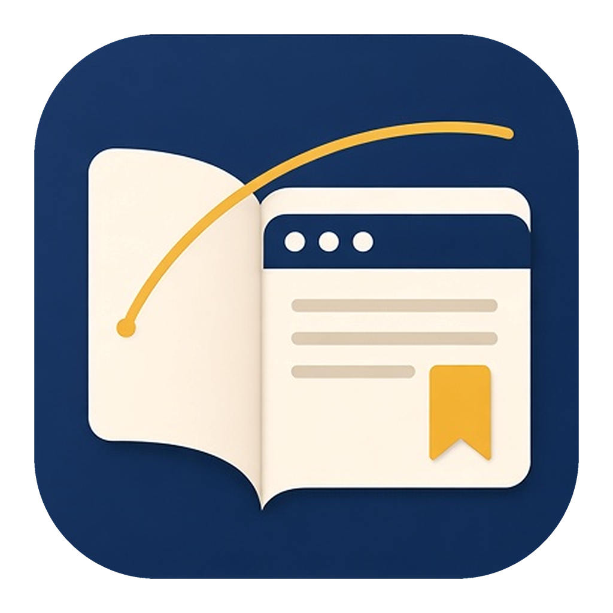

# 巡页Xunye

<p align="center">
  
</p>

巡页是本地优先的 Android **浏览器 + 阅读器**：在应用内打开网页，一键净读去噪后的小说正文、图文或漫画，嗅探到视频时用净视原生播放；并支持网页/净读翻译与可配置的 AI 助手。书签、历史、下载与阅读列表默认留在本机，可选 WebDAV 备份。

- **展示名**：巡页Xunye（启动器图标名：**巡页**）
- **仓库**：https://github.com/yanfan-cn/xunye
- **包名**：`com.xunye.app`
- **ABI**：仅 arm64-v8a
- **系统要求**
  - **默认 Aloha 包**（捆绑 Chromium）：**Android 10+**（API 29）。Aloha Core / 现行 Chromium 按上游以 Android 10 为最低支持。
  - **无 Aloha 旁路包**（`systemWv`，使用系统 WebView）：现行包按工程 **minSdk 28**，需 **Android 9+**；体积更小，无捆绑 Chromium，能力与默认包不完全等同（见 SPEC-222）。早期未升 minSdk 的包曾可在 Android 8.1 安装使用，**不以现行包为准**。
- **版本**：Debug 见 `upstream/Xunye/app/version.properties`；正式 Release 见 `version-release.properties`（当前正式线自 **1.0.x**）。可在 [Releases](https://github.com/yanfan-cn/xunye/releases) 下载已签名 APK。

底栏三个主入口：**浏览器**、**阅读列表**、**我的**。

## 实机截图

### 手机

| 主页浅色 | 主页深色 |
| --- | --- |
|  |  |

| 网页浏览 | 标签页 | 收藏 |
| --- | --- | --- |
|  |  |  |

| 工具箱 | 阅读列表 | 阅读记录 |
| --- | --- | --- |
|  |  |  |

| 净读竖屏滚动 | 净读设置 | 净读更多设置 |
| --- | --- | --- |
|  |  |  |

| 净视横屏播放 |
| --- |
|  |

### 平板电脑

| 横屏浅色 | 横屏深色 |
| --- | --- |
|  |  |

| 净读横屏双栏 | 阅读列表 |
| --- | --- |
|  |  |

| 工具箱 | 听书播放器 | 设置页 |
| --- | --- | --- |
|  |  |  |

## 技术底座

| 能力 | 技术来源 |
| --- | --- |
| 净读 | 基于 **Legado with MD3** 开发。网页抽取后进入其原生小说 / 漫画阅读器。 |
| 净视 | 基于 **ExoPlayer**（Media3）开发的原生播放。 |
| 浏览器内核（默认） | 源自 **Aloha Core**（捆绑 Chromium）；需 **Android 10+**。 |
| 旁路变体 | `systemWv` flavor 走系统 WebView（无 Aloha AAR），**Android 9+**；**不**替代默认产品内核。 |
| 翻译 | 默认本机 **Bergamot**（Foxlet）；可选 Google 或应用内已配置 AI。 |
| AI 助手 | 用户自备 API / 模型配置；对话与书架、目录、笔记等本地能力衔接。 |

## 主要功能

### 浏览器

- 多标签，可恢复上次浏览的页面。新标签页提供搜索与地址、快捷书签，也可放阅读列表卡片和壁纸。
- 书签、历史、下载；用户代理可在手机与电脑之间切换；支持 Force Dark、护眼、无痕、页内查找和字体缩放。
- 净化包括内置广告规则拦截、阻止弹窗、可选阻止唤起其它应用，以及点选屏蔽。请求拦截和净读的正文抽取是两层能力。
- 桌面快捷方式：收藏、新建标签、扫一扫、阅读列表。

### 翻译

- **网页就地翻译**：在当前页直接替换文案，无需套壳新开页；工具箱可一键译 / 还原（平板另有顶栏入口）。
- **净读全文翻译**：进入净读后可翻译本章正文。
- 默认本机 Bergamot，也可选用 Google 或已配置的应用 AI；自动翻译默认关闭。

### 净读

净读模式对当前网页做去噪阅读：用脚本做启发式抽取，滤掉壳层、广告和控件文案，再打开原生阅读器。

- 三种模式：文本、图文混合、图片（漫画）。
- 短按进入净读并自动判断模式；长按可选手动模式、极致净化等。
- 可设为手动、自动识别，或按站点自动进入。无痕浏览不会自动进入净读。
- 页面结构不适合抽取时，回到普通浏览。效果因站点而异。
- 双击图片可全屏查看：支持双指缩放；可打开「全部照片」浏览本页缩略图。

### 净视

嗅探到可播放的流之后，用原生播放器观看。入口是**净视胶囊**，可以收成悬浮球。

- 支持全屏、画中画、倍速、手势、听音频、DLNA 投屏和下载；站点提供多档清晰度时可以切换。
- 净读正文里的视频缩略图可以一键进入净视。
- 加密、需要鉴权，或只锁在网页播放器里的流，不一定能被嗅探到。效果因站点而异。

### AI 助手

配置模型后，可从浏览器主页或「我的」进入对话。

- **阅读与检索**：查书架、看目录、读已缓存原文（含相邻章节）、章节内关键词搜索；查进度与阅读统计。
- **理解与梳理**：章节总结、人物档案与关系、世界观 / 设定、大纲层级、笔记与书签搜索。
- **辅助创作**：按已有设定维护人物 / 事件 / 关系 / 世界观 / 大纲；续写、改写、润色建议。
- **其他**：联网搜索实时信息、一般知识问答；记住偏好供后续对话使用。

### 净读与净视

| | 净读 | 净视 |
| --- | --- | --- |
| 目标 | 去噪阅读文章或漫画 | 用原生播放器观看网页视频 |
| 手段 | 从页面抽取内容，进入原生阅读器 | 嗅探媒体流，进入原生播放器 |
| 技术来源 | Legado with MD3 | ExoPlayer（Media3） |
| 主入口 | 净读按钮 | 净视胶囊 / 悬浮球 |

### 阅读列表与本地数据

阅读列表、阅读界面设置、备份与恢复都在本机完成。可以选用 WebDAV，也可以选用局域网 Web 服务。数据默认留在设备上；隐私取向见应用内隐私政策。

## 本机构建与安装（Windows）

目前以自行构建安装为主。工程与 Gradle 家目录须同盘，避免 KSP `different roots`：

```powershell
$env:GRADLE_USER_HOME = "D:\cursor\.gradle-home"
cd D:\cursor\Xunye\upstream\Xunye
.\gradlew.bat :app:assembleAlohaDebug
```

- 默认产品（Aloha / Chromium）：`assembleAlohaDebug` 或 `assembleAlohaRelease`（需 **Android 10+**）
- 旁路（系统 WebView，无 Aloha）：`assembleSystemWvDebug` / `assembleSystemWvRelease`（需 **Android 9+**）

版本与 APK 命名约定见 SPEC-108 / SPEC-244（`巡页` + `MAJOR.MINOR.PATCH` 或 `-beta`）。正式包亦可从 [GitHub Releases](https://github.com/yanfan-cn/xunye/releases) 下载（仅 arm64-v8a）。

## 开源许可

整体遵循 **GNU GPL-3.0**（及上游项目要求）。发行物另含 Chromium 等第三方组件，各按其自身许可证提供。详见应用内「开源许可」与 `upstream/Xunye/app/src/main/assets/LICENSE.md`。

## 免责声明（摘要）

巡页提供本地浏览与阅读辅助能力，不运营第三方内容库，也不替用户托管网页内容。用户自行访问的网站由用户设备直接发起网络请求；请遵守当地法律法规与站点服务条款。完整条款见应用内「用户隐私与协议」「免责声明」（`privacyPolicy.md` / `disclaimer.md`）。

## 开发文档入口

| 文档 | 说明 |
| --- | --- |
| [`specs/CONSTITUTION.md`](specs/CONSTITUTION.md) | 开发宪章（不可由 Agent 自行修改） |
| [`AGENTS.md`](AGENTS.md) | Agent 开工入口 |
| [`docs/产品与开发决策基线.md`](docs/产品与开发决策基线.md) | 产品与技术决策基线 |
| [`specs/AO_README.md`](specs/AO_README.md) | Spec / Plan / Log 流程说明 |
| [`docs/会话状态交接.md`](docs/会话状态交接.md) | 跨会话状态交接 |

### 开发流程

```text
复述确认 → SPEC-XXX → PLAN-XXX → 实施 → LOG-XXX → 验证交付
```

功能三件套同号：`specs/features/SPEC-XXX.md`、`specs/plans/PLAN-XXX.md`、`specs/logs/LOG-XXX.md`。

## 状态

产品代码在 `upstream/Xunye` 持续迭代；需求与验收以 `specs/` 与 `docs/` 为准。
